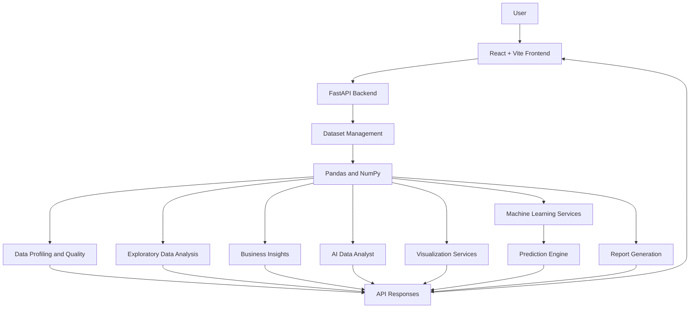

# DATASTORY – AI-Powered Data Analysis & Intelligence Platform

<p align="center">
  
</p>

<p align="center">
  <strong>Turn raw data into meaningful insights, visualizations, predictions, and decisions.</strong>
</p>

<p align="center">
  
  
  
  
  
  
</p>

---

## About DATASTORY

**DATASTORY** is an AI-assisted data analysis and intelligence platform designed to simplify the complete data analysis workflow.

It provides a unified workspace where users can upload datasets, explore data quality, perform exploratory data analysis, generate visualizations, interact with data using natural language, build machine learning models, make predictions, and generate analytical reports.

Instead of switching between multiple tools for different analysis tasks, DATASTORY brings these capabilities together in one platform.

The project aims to make data analysis more accessible, understandable, and actionable for students, analysts, researchers, and business users.

### The core idea

**Raw Data → Data Understanding → Data Cleaning & Quality → Analysis → Visualization → Intelligence → Prediction → Reporting**

---

## Project Preview

<p align="center">
  
  <br>
  <em>DATASTORY main dashboard – replace this image with your latest screenshot.</em>
</p>

### Main modules

| Module | Description |
|---|---|
| Dashboard | Central analytics workspace |
| My Datasets | View uploaded datasets |
| Data Explorer | Explore dataset structure and statistics |
| AI Data Analyst | Ask natural-language questions about data |
| Visualizations | Generate charts and explore relationships |
| Business Insights | Discover meaningful patterns and findings |
| Machine Learning | Train and evaluate ML models |
| Model Prediction | Generate predictions using trained models |
| Reports | Export analytical reports |
| Report Studio | Create AI-assisted and manual reports |

---

## Features

### 1. Dataset Upload & Management

Upload datasets in supported formats:

- CSV
- Excel
- JSON

The platform provides dataset management functionality and allows users to access uploaded datasets for further analysis.

### 2. Data Explorer

Understand the structure and quality of your dataset.

Features include:

- Dataset dimensions (rows and columns)
- Column names and data types
- Missing value analysis
- Duplicate record analysis
- Numerical and categorical column identification
- Statistical summaries
- Dataset preview
- Data quality assessment

### 3. Data Quality Assessment

Evaluate the quality of uploaded data using automated checks.

The analysis includes:

- Missing values
- Duplicate records
- Data type information
- Numerical and categorical characteristics
- Data quality indicators

The purpose is to help users identify potential data issues before performing further analysis.

### 4. Automated Data Visualization

Generate visual representations of datasets using automatic recommendations and manual chart configuration.

Supported visualizations include:

- Bar charts
- Line charts
- Pie charts
- Donut charts
- Histograms
- Scatter plots
- Correlation matrices

Additional capabilities:

- Select datasets and columns
- Group data by categorical columns
- Apply aggregation operations
- Compare Sum, Average, Count, Minimum, and Maximum
- Export charts as PNG images

### 5. AI Data Analyst

Interact with datasets using natural-language questions.

Users can ask questions about numerical values, dataset characteristics, and patterns in their data.

Capabilities include:

- Natural-language question handling
- Pandas-based calculations
- Dataset-related answers
- Chart generation from supported natural-language requests
- Chart explanations
- Visual results inside the conversation
- PNG chart export

**Implementation note:** The current question-answering engine uses deterministic data processing and Pandas calculations. It does not require an external paid LLM API.

### 6. Business Insights

Automatically generate business-oriented findings from datasets.

The module provides:

- Dataset summaries
- Important numerical observations
- Category-level findings
- Missing-data observations
- Duplicate-data observations
- Analytical recommendations

Insights are generated from the available dataset and calculated results.

### 7. Machine Learning Lab

Train and compare machine learning models using uploaded datasets.

**Classification algorithms**

- Logistic Regression
- Decision Tree Classifier
- Random Forest Classifier
- K-Nearest Neighbors

**Regression algorithms**

- Linear Regression
- Decision Tree Regressor
- Random Forest Regressor

**Model evaluation**

Classification metrics:
- Accuracy
- Precision
- Recall
- F1-score
- Confusion matrix

Regression metrics:
- Mean Absolute Error (MAE)
- Mean Squared Error (MSE)
- Root Mean Squared Error (RMSE)
- R² Score

Additional capabilities:

- Numerical and categorical preprocessing
- Missing-value imputation
- Feature scaling
- Categorical encoding
- Train/test split
- Model comparison
- Best-model selection
- Permutation feature importance

### 8. Model Prediction Lab

Use successfully trained models to make predictions on new input values.

Features include:

- Select a trained model
- Dynamically generate prediction input fields
- Handle numerical and categorical inputs
- Display prediction results
- Display class probabilities when supported
- View prediction history during the current component session

**Important:** Trained models are currently maintained in backend memory. Restarting the backend clears the in-memory training sessions, so the model must be trained again.

### 9. Reports & Export Center

Generate downloadable reports from uploaded datasets.

Supported exports:

- PDF reports
- Excel reports
- CSV exports

PDF reports include analytical summaries, dataset information, column profiles, statistical summaries, business insights, and recommendations.

Excel reports organize information into separate worksheets, including dataset information, overview, column analysis, statistics, business insights, and recommendations.

### 10. Report Studio

Create structured analytical reports using AI-assisted and manual report-building workflows.

Current capabilities include:

- AI-assisted report generation
- Report titles and report configuration
- Dataset-based KPIs
- Recommended visualizations
- Findings and recommendations
- Multi-page manual report canvas
- Add KPI components
- Add charts and data tables
- Add text components
- Edit, duplicate, and delete components
- Rename report pages
- Preview reports

The manual builder currently uses dataset preview rows for its chart and table data. Full-dataset querying and advanced interactive reporting are planned improvements.

---

## Technology Stack

| Category | Technologies |
|---|---|
| Frontend | React.js, Vite |
| UI & Icons | CSS, Lucide React |
| Charts | Recharts, Plotly-related visualization capabilities in the backend workflow |
| Frontend API | Axios |
| Backend | Python, FastAPI |
| Data Processing | Pandas, NumPy |
| Machine Learning | Scikit-learn |
| Statistical Analysis | SciPy |
| Excel Processing | OpenPyXL |
| PDF Generation | ReportLab |
| Database | SQLite – planned for persistent project history |
| API Testing | Swagger UI |
| Version Control | Git and GitHub |

---

## System Architecture

DATASTORY follows a frontend-backend architecture.



### How it works

1. The user uploads a dataset through the React frontend.
2. Axios sends the request to the FastAPI backend.
3. The backend validates and processes the dataset.
4. Pandas and NumPy perform data analysis and calculations.
5. Scikit-learn handles supported machine learning workflows.
6. The backend returns structured results through REST APIs.
7. React displays results through dashboards, charts, reports, and interactive components.

---

## Project Structure

The project is organized into separate frontend and backend applications.

```text
DATASTORY/
│
├── backend/
│   ├── app/
│   │   ├── api/
│   │   │   └── dataset_routes.py
│   │   │
│   │   ├── ml/
│   │   │   └── training_service.py
│   │   │
│   │   ├── services/
│   │   │   ├── dataset_service.py
│   │   │   ├── reports_service.py
│   │   │   └── report_intelligence_service.py
│   │   │
│   │   └── main.py
│   │
│   ├── datasets/
│   ├── generated_reports/
│   ├── .venv/
│   └── requirements.txt
│
├── frontend/
│   ├── src/
│   │   ├── components/
│   │   │   ├── UploadDataset.jsx
│   │   │   ├── MyDatasets.jsx
│   │   │   ├── DataExplorer.jsx
│   │   │   ├── Visualizations.jsx
│   │   │   ├── AIDataAnalyst.jsx
│   │   │   ├── BusinessInsights.jsx
│   │   │   ├── MachineLearning.jsx
│   │   │   ├── ModelPrediction.jsx
│   │   │   ├── Reports.jsx
│   │   │   ├── ReportStudio.jsx
│   │   │   └── ManualReportBuilder.jsx
│   │   │
│   │   ├── services/
│   │   │   └── api.js
│   │   │
│   │   ├── App.jsx
│   │   ├── App.css
│   │   └── main.jsx
│   │
│   ├── public/
│   ├── package.json
│   └── index.html
│
├── docs/
│   └── images/
│
├── .gitignore
└── README.md
```

*This is a representative structure. Some files or folders may differ depending on your latest local project version.*

---

## Installation & Setup

Follow these steps to run DATASTORY locally.

### Prerequisites

Install the following:

- Python 3.11 or later
- Node.js and npm
- Git
- Visual Studio Code (recommended)

### Step 1: Clone the repository

```bash
git clone https://github.com/YOUR_USERNAME/DATASTORY.git
```

Navigate to the project:

```bash
cd DATASTORY
```

### Step 2: Set up the backend

Open a terminal and navigate to the backend:

```bash
cd backend
```

Create a Python virtual environment:

```bash
python -m venv .venv
```

Activate it on Windows CMD:

```cmd
.venv\Scripts\activate
```

Install the backend dependencies:

```bash
python -m pip install -r requirements.txt
```

Start the FastAPI development server:

```bash
uvicorn app.main:app --reload
```

Backend API:

```text
http://127.0.0.1:8000
```

Swagger API documentation:

```text
http://127.0.0.1:8000/docs
```

### Step 3: Set up the frontend

Open a second terminal.

Navigate to the frontend:

```bash
cd frontend
```

Install dependencies:

```bash
npm install
```

Start the Vite development server:

```bash
npm run dev
```

Open the frontend in your browser:

```text
http://localhost:5173
```

**DATASTORY is now running locally.**

---

## Screenshots

Add screenshots of your actual running application in the `docs/images/` folder.

### Dashboard


### Dataset Explorer


### Data Visualization


### AI Data Analyst


### Business Insights


### Machine Learning Lab


### Model Prediction


### Reports & Export


### Report Studio


*Replace these image references with screenshots captured from your actual application. Do not commit placeholder or fabricated screenshots as completed features.*

---

## Sample Use Case

Imagine a user has a customer dataset containing customer age, monthly spending, visits, support tickets, and churn information.

Using DATASTORY, the user can:

1. Upload the customer dataset.
2. Inspect missing values and column information.
3. Explore numerical and categorical variables.
4. Generate charts and grouped analysis.
5. Ask questions through the AI Data Analyst.
6. Generate business findings.
7. Train a classification model to predict customer churn.
8. Compare model performance.
9. Enter new customer details in the Model Prediction Lab.
10. Export an analytical report.

This demonstrates how DATASTORY combines data analytics and machine learning in a single workflow.

---

## Current Development Status

| Component | Status |
|---|---|
| Dataset Upload | Implemented |
| Dataset Management | Implemented |
| Data Explorer | Implemented |
| Data Quality Assessment | Implemented |
| Automated Visualizations | Implemented |
| Grouped Analysis | Implemented |
| AI Data Analyst | Implemented |
| Business Insights | Implemented |
| Machine Learning Lab | Implemented |
| Model Prediction | Implemented |
| PDF / Excel / CSV Export | Implemented |
| AI Report Generator | Implemented |
| Manual Report Builder | Initial version implemented |
| Persistent Model Storage | Planned |
| Advanced Interactive Reports | Planned |

---

## Future Roadmap

The following capabilities are planned for future releases.

- [ ] Smart Data Quality Guardian with automated cleaning suggestions
- [ ] Advanced AI Data Copilot
- [ ] Root Cause Analysis Engine
- [ ] Forecasting and What-If Simulator
- [ ] Live Dashboard Statistics
- [ ] Dataset Comparison Engine
- [ ] Advanced AutoML and model recommendations
- [ ] Smart KPI Alerts and Monitoring
- [ ] Data Lineage and Transformation History
- [ ] Advanced Report Studio with interactive filters
- [ ] PowerPoint report export
- [ ] Persistent report and model history
- [ ] User authentication and workspace management
- [ ] Shareable analytics reports

---

## Design Philosophy

DATASTORY is built around the following principles:

- **Simplicity:** Make complex analytical tasks easier to understand.
- **Automation:** Reduce repetitive manual analysis.
- **Transparency:** Present findings with supporting calculations.
- **Accessibility:** Make analytics approachable for different user skill levels.
- **Actionability:** Help users move from observations to informed decisions.
- **Modularity:** Keep the platform extensible for future capabilities.

---

## Limitations & Notes

- AI Data Analyst answers are currently based on deterministic calculations and supported question patterns, not a general-purpose LLM.
- Machine learning training sessions are stored in backend memory and are lost when the backend restarts.
- The manual Report Studio currently uses dataset preview rows for its data components.
- Dashboard statistics and recent activity currently contain demonstration values rather than fully dynamic workspace metrics.
- Model performance depends on dataset quality, target selection, feature selection, and validation methodology.
- Synthetic sample datasets are intended for demonstration and testing, not real-world business conclusions.

---

## Contributing

Contributions, suggestions, and improvements are welcome.

1. Fork this repository.
2. Create a new feature branch.
3. Implement your changes.
4. Test the changes locally.
5. Submit a pull request with a clear description.

---

## License

This project is intended to be released under the MIT License.

Add a `LICENSE` file to the repository before describing the project as officially licensed under MIT.

---

## Author

**Mukesh Mandala**

B.Tech – Computer Science and Engineering (Data Science)

Interested in Data Analytics, Data Science, Machine Learning, and building practical AI-powered applications.

---

<p align="center">
  <strong>DATASTORY – Your Data. Your Insights. Smarter Decisions.</strong>
</p>

<p align="center">
  If you find this project interesting, consider giving the repository a ⭐.
</p>
